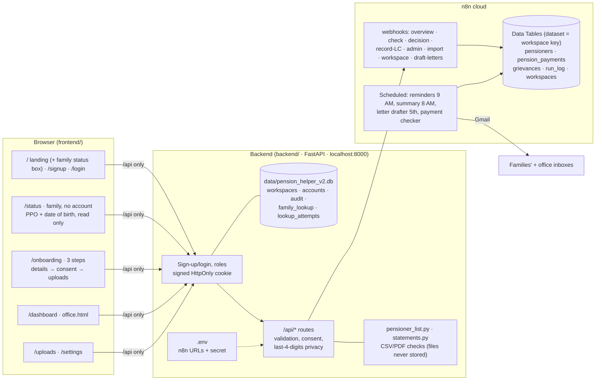

# Pension Helper — Project Plan

## What this is
**Pension Helper** is an AI automation built for the **Homingo hackathon, Automation track, B2: AI for the government office**.

It helps a pension office (or a pensioner's family) with three jobs:
1. **Life certificate deadlines.** Checks who still needs to submit their yearly life certificate (Jeevan Pramaan) and sends reminders before the deadline.
2. **Pension payment checks.** Compares the pension each person *should* get with what was actually paid, and flags missing or short payments.
3. **Grievance letters.** When something is wrong, AI drafts a clear, polite complaint letter that a person checks before sending.

## How to work with the user (important)
- The user is a **complete beginner and will not write code**. Claude does all the building.
- Explain every step in **plain, simple language**. No jargon without a one-line explanation.
- Before any big step, say what will happen and what the user will see. Ask before anything that sends messages, costs money or deletes things.
- Keep changes small and show results after each phase.

## Architecture (frontend + backend + n8n)

- **The browser never sees n8n.** Pages only call `/api/...` on the backend; the n8n webhook URLs live only in `backend/.env` (git-ignored). A test confirms no page or script contains an n8n URL.
- **Run it:** `start.bat` (double-click or type it) starts the backend, which also serves the pages, and opens http://localhost:8000. First run builds `backend/.venv` from `backend/requirements.txt`. Claude's preview uses the `pension-helper` entry in `.claude/launch.json` (same command).
- **App flow (Phase 10):** Landing `/` → `/signup` (email + password, Pension Office only; "Forgot password" is a placeholder) or `/login` → `/onboarding` (3 steps with progress bar: details → consent → upload documents) → `/dashboard`. Pages redirect to the right step until onboarding is finished.
- **Family status check (Phase 11, no account):** big "Check your pension status" box on the landing page (`#check`, Hindi/English) → PPO number + date of birth → `POST /api/status/lookup` → signed HttpOnly cookie `ph_status` (30 min, workspace id + pensioner id) → `/status` (read-only: life certificate, payments month by month, complaint tracker, next steps; Hindi/English; "Check another pensioner" clears it).
  - **Fingerprint only:** backend table `family_lookup` stores HMAC-SHA256(`LOOKUP_SECRET`, or `SESSION_SECRET` if unset, of `ppo_digits|dob_iso`) → (workspace, pensioner id). The full PPO and the date of birth are never stored or sent to n8n. Set when the office uploads a list with `date_of_birth`, adds a pensioner with a date of birth, or edits with both PPO + date of birth; removed on delete. If the same fingerprint is in two office workspaces, the newest wins.
  - **Wrong tries:** table `lookup_attempts` per device (client IP): 5 wrong → 429 "wait 10 minutes" (even right details wait). Typing mistakes (bad format) don't count. Success resets.
  - **What the family gets** (whitelist): name, age, bank, language, ppo_last4, life_certificate, payments, letters for that name (id, status, timeline, amount, bank, letter text), office name. No emails, account numbers or consent details.
  - **Family accounts are gone:** sign-up refuses `role=family` (403), old family accounts can't log in (403 with a pointer to the box) and their sessions no longer count. `family.html`/`family.js` were removed; `onboarding.js` still has an unused family branch.
- **Workspaces + accounts:** SQLite `backend/data/pension_helper_v2.db` (git-ignored; env `PH_DB_PATH` overrides, used by tests). Each sign-up creates one **workspace** with a random key `w` + 9 digits; that key is the `dataset` value on every n8n row, so each account only sees its own data. Passwords = PBKDF2-SHA256, 240k iterations, random salt; 5 wrong → locked 10 min; password change bumps `token_version`. Important actions go to the `audit` table (Settings shows it). The old `pension_helper.db`, `/setup`, `/account`, `/citizen`, demo accounts and the Demo/Real switch were **removed** in Phase 10.
  - **Office:** dashboard, upload pensioner list + statements, add/edit/delete pensioners, record certificates, "Draft letters now", approve/track letters, DA rates (per workspace).
  - **Family:** no account since Phase 11 (see the family status check above). The office drawer shows "Family status check: On/Off" (`online_check` in the office overview).
- **Old demo rows** (the 20 Phase 1 pensioners, `dataset='demo'`) are still in the tables but are never shown and are skipped by all scheduled jobs. The dashboard has no DEMO tag.
- **Pensioner list upload** (`backend/pensioner_list.py`): CSV template at `/api/templates/pensioner-list.csv`. Required: name, age (or date_of_birth), bank, language, ppo_number, basic_pension; optional: date_of_birth (DD/MM/YYYY; age is worked out from it; turns on the family status check), bank_account_number, commuted_amount, family_email, jeevan_pramaan_id + certificate_date. All-or-nothing: any bad row → 422 with `errors[{row, field, message}]`, nothing saved. Saved via workflow 8 `create_many`.
- **Statement matching:** several statements at once; each is matched to a pensioner by the account number's last 4 digits (PPO last 4 breaks ties; single pensioner = automatic), user can change the match before saving.
- **Sample files:** `sample_uploads/` (made by a scratchpad script; see its README): `pensioner_list.csv` (12 people, 3 already verified), `pensioner_list_with_errors.csv` (6 errors), 5 office statements (3 CSV, 2 PDF: missing month, DA not applied, short + missing, two all OK), `family_statement_kamla_devi_SBI.csv`, `not_a_statement.csv`.
- **Pensioner form (office):** validation in the browser AND the backend (name letters only 2–80, age 40–120, language from list, PPO 6–20 digits required on add, bank account 6–20 digits optional, basic pension ₹500–₹10,00,000, commuted < basic, valid email). Duplicate names in the same workspace refused (names link payments/letters). Consent is given once per workspace in onboarding step 2; `consent_given_at` + `consent_by` stored on each pensioner. Edit renames payments/letters too; delete removes the pensioner, payments, letters and run-log rows (type-the-name confirmation).
- **Privacy:** full PPO and bank account numbers never leave the backend: only the last 4 digits are sent to n8n and stored. Statement files are read in memory and never saved; only monthly totals are kept; long digit runs are masked (`••••1234`) in previews. Office overview includes family email (needed for editing); family responses never include emails or account numbers.
- **Bank statements:** `backend/statements.py` reads CSV (finds the header row; Date / Description|Narration|Particulars / Credit|Deposit or Amount+Type) or text PDFs (pypdf; scanned PDFs refused with a message). Pension credits = credit lines mentioning PENSION / PENS / PPO / पेंशन; summed per month. A month fully covered by the statement but with no pension credit = 0 (missing). Two steps: upload → preview (tick/untick months, 15-min token tied to the user and pensioner) → confirm → n8n `import-payments` upserts one row per month (using the pensioner's basic pension + commuted). Max 5 MB.
- **DA rates:** per workspace, on the Settings page (office) → n8n `workspaces` table (`da_old`, `da_new`, `da_new_from`; defaults 55 / 58 from 2026-07). Workflows read the rates of each row's workspace.
- **Backend API:** auth `POST /api/signup`, `/api/login`, `/api/logout`, `GET /api/me`, `POST /api/me/password`; onboarding `GET /api/onboarding`, `POST /api/onboarding/details|consent|finish`; uploads `GET /api/templates/pensioner-list.csv`, `POST /api/upload/pensioner-list`, `POST /api/upload/statements` (multi-file `files`, optional `pensioner_id`) + `/confirm {items:[{token, pensioner_id, months}]}`; data `GET /api/overview`, `POST /api/pensioners`, `PUT|DELETE /api/pensioners/{id}`, `POST /api/pensioners/check`, `/api/pensioners/record-certificate`, `POST /api/letters/{id}/decision`, `POST /api/letters/draft-now`, `GET|PUT /api/settings`; family (no account) `POST /api/status/lookup {ppo_number, date_of_birth}` (404 `not_found` + `attempts_left`, 429 `locked` + `wait_seconds`, 422 `invalid`), `GET /api/status`, `POST /api/status/leave`. Validation errors: `{"detail", "fields"}` (forms) or `{"detail", "errors"}` (list upload). Another workspace's pensioners/letters → 404.
- **Tests live in `tests/`** (run with `backend\.venv\Scripts\python.exe tests\flow_test.py` / `tests\status_test.py`; each starts its own server with a throwaway accounts DB, uses the real n8n incl. a few Claude letters, and deletes its pensioners afterwards). `flow_test.py` = whole app incl. the new family flow: **66/66** (2026-11-23); `status_test.py` = **42/42**.
- **Design (Phase 12, frontend only, 2026-11-23):** `frontend/assets/styles.css` = design system: deep indigo `#4338ca` + saffron `#ff9933`, soft gradient background, glass cards (`backdrop-filter`), 20px corners, Plus Jakarta Sans (+ Noto Sans Devanagari). Colours are CSS variables; dark theme = `html[data-theme="dark"]`. Every page's `<head>` has a tiny script that sets the theme before first paint (saved choice `localStorage ph-theme`, else the system setting) and `<link rel="icon" href="/assets/favicon.svg">`.
  - **`frontend/assets/ui.js`** (after `common.js`, with GSAP 3.12.5 from cdnjs): theme toggle (any `` becomes a sun/moon button; `mountShell` adds it to the sidebar and phone bar), hero words fade/slide in, "How it works" pipeline (dot travels, steps light up; `.pipeline`), count-up numbers (`data-count`, `data-format="inr"`, `data-prefix/suffix`, `data-count-key` = animate from the last value), fade-up on scroll (`PH.reveal(scope)`; containers with `data-auto-reveal` re-run it when filled), page fade-out on internal links. Without GSAP (offline) everything still shows, just without motion.
  - **Reduce motion** is respected (CSS + JS). **This computer has Windows "Animation effects" off**, so motion is hidden here unless a page is opened once with **`?motion=on`** (stored in `localStorage ph-motion`; `?motion=auto` resets).
  - Landing status check shows a loading animation (`#check-loading`, ≥1.25 s) before `/status`; result cards fade up one by one. Skeleton loaders on dashboard, status, uploads, settings, onboarding.
  - **Screenshots:** `docs/screenshots/` (light + dark, desktop + phone), made by a scratchpad Playwright script using the installed Edge; it also checks console errors (0) and that no page is wider than a phone screen.
- **Render deployment (2026-11-23):** one free web service. Build `pip install -r backend/requirements.txt`, start `uvicorn app:app --app-dir backend --host 0.0.0.0 --port $PORT` (no `--forwarded-allow-ips "*"`: on Windows uvicorn/click expands `*` as a file glob), health check `/healthz`; `render.yaml` at the repo root. On Render (`RENDER=true`): cookies are `secure`, and `_client()` uses the LAST `X-Forwarded-For` entry for the wrong-tries limit.
  - **Disk is wiped on restart → backup in n8n:** workflow 12 **Backend Store** `g1Jtjxe04gyiZNTe` (`POST /webhook/backend-store`, secret header; actions get_all / put / put_many / delete) + table **`backend_store`** `GLpiqazJluMUktLz` (key, value, updated_at). With env `N8N_STORE_URL` set, `db.py` queues every workspace (`ws:<id>`), account (`acc:<id>`, password hash fields only) and fingerprint (`lk:<ws>:<pid>`) write and a background thread sends them in batches (`put_many`); at startup an EMPTY accounts DB is refilled (`restore_from_backup`). Audit log + wrong-password counters are NOT backed up. `N8N_STORE_URL` must stay EMPTY locally (one backup per hosted copy; local and Render would otherwise mix IDs).
  - **Sample office seed:** env `SEED_OFFICE_EMAIL`, `SEED_OFFICE_PASSWORD` (10+), `SEED_WORKSPACE_KEY` (the local `office.demo` workspace key, in git-ignored `demo_logins.md`). On every start, if the account is missing it is created (onboarding done) on that key, and if that workspace has no family fingerprints they are rebuilt from `sample_uploads/pensioner_list.csv` (PPO + date of birth matched by name).
  - **Test:** `tests/render_test.py` (two servers, empty DB each, real n8n, no AI cost) = **15/15**; it EMPTIES `backend_store` afterwards, so never run it while Render is live.
  - Manual-upload deployment: the user uploads files to GitHub via the website; `upload_to_github/` (git-ignored) holds a copy of the public files.
  - **LIVE (2026-11-26): https://pension-helper-1.onrender.com** (Render service `pension-helper-1`, all env vars set). Verified from outside: `/healthz` ok, family check Ramprasad → ₹50,560 pending, office account `office.demo@example.com` exists (password = the user's `SEED_OFFICE_PASSWORD`, not stored here). Backup holds ws:1, acc:1, 12 fingerprints. Note: on 2026-11-25 ~12:09 IST the n8n Cloud instance stopped executing ALL workflows ("There was a problem executing the workflow") until the user upgraded n8n; a free-plan wake-up restarts the app, which re-runs restore + seed.
- **Snapshot:** commit "before redesign" + git tag `before-redesign` (2026-11-23). To go back: `git checkout before-redesign` (look) or ask Claude to restore it.
- **Tests, Phase 11 (2026-11-23):** `status_test.py` = **42/42 passed** (port 8097, throwaway DB, real n8n): landing box, family sign-up/login refused, office onboarding + list with dates of birth (12 online) + statements + Claude letters + approve, Ramprasad and Savitri found by PPO + date of birth, status shows certificate/payments/tracker, nothing private leaks, tampered cookie refused, office edit/add/delete keep the fingerprint right, 5 wrong tries → 10-minute wait, office login unaffected. Browser: landing box in Hindi → Savitri's status page in Hindi and English, "Check another pensioner". `flow_test.py` was updated for the new family flow (family sign-up refused, status check for Ramprasad and Kamla).
- **Tests (2026-11-23, Phase 10):** scratchpad `flow_test.py` = **63/63 passed** (separate server, throwaway DB, real n8n incl. Claude letters; deletes its pensioners afterwards). Browser walkthrough on a test server: landing, sign-up, onboarding steps 1–3, list upload (12 added), statement upload (matched + "not a statement" error), dashboard with sidebar and no DEMO tag, empty state for a new account, Uploads and Settings pages. Test pensioners deleted from n8n afterwards; empty test workspace rows remain (harmless, no pensioners).
- **n8n is locked to the backend** (2026-11-23): the backend sends header `X-Pension-Key` (value = `N8N_SHARED_SECRET` in `backend/.env`) on every n8n call. All backend webhook workflows (2, 4a's draft-letters webhook, 4b, 6, 7, 8, 9, 11) have the Webhook option **Only Run If** = `{{ $json.headers['x-pension-key'] === '<secret>' }}`. Without the right key n8n replies `{"message":"Webhook call received"}` and runs nothing. **To change the secret:** update `backend/.env` AND the Only Run If expression in all those webhooks, then publish them; otherwise the app shows "n8n sent an unexpected reply".
- **Troubleshooting "Cannot read properties of undefined (reading 'lc_pending')" / "Updated Invalid Date"** (2026-11-23): this came from a stale browser tab of the **old** dashboard at `localhost:5173` (removed in Phase 7). It still called n8n directly, and since the n8n lock n8n answers it with `{"message":"Webhook call received"}` (no data). The real app is **http://localhost:8000** only. Guards added: the backend returns a clear 502 if the overview reply is incomplete, and the office page shows "The server sent incomplete data…" (keeping the last good numbers) instead of crashing.
- **Git:** this machine has no `git` on PATH; use GitHub Desktop's bundled git at `%LOCALAPPDATA%\GitHubDesktop\app-3.6.10\resources\app\git\cmd\git.exe`.

## Engine: n8n
- Instance: `https://richal.app.n8n.cloud`, personal project id `WQ1OTJBlrB0VgDm9`.
- Claude builds and edits workflows through the **n8n connector** (MCP). Before building, read instance context and user preferences (none saved yet).
- Data lives in **n8n Data Tables**. Pensioners are linked across tables by **`name` + `dataset`** (exact match); webhooks that change one pensioner use its row `id`.
- **Every workflow code node starts the same way:** read `Get workspaces` (n8n `workspaces` table) → DA rates per workspace key. Webhooks get the `dataset` (workspace key, must match `^w\d{1,9}$`) from the backend and only touch rows with that `dataset`; scheduled jobs loop over all real workspaces and skip `dataset='demo'`. Keep `alwaysOutputData` on table reads so an empty workspace still answers.
- AI steps use the n8n Anthropic node (currently `claude-sonnet-5`), with a template fallback if the AI is busy.

## Data tables (demo data only — never real Aadhaar, PPO or bank numbers)
| Table | id | Columns |
|---|---|---|
| `pensioners` | `CYRmkrrnEUVry94Q` | name, age, ppo_last4, bank, family_email, language, lc_submitted, lc_submitted_on, **pramaan_id**, **lc_verified_until** (date), **lc_recorded_by** (office/family) |
| `pension_payments` | `ehw1P5kSSm4LjD8n` | name, month (`yyyy-MM`), amount_received, basic_pension, commuted_amount |
| `grievances` | `rIrkxZXlFn67OxmU` | name, bank, issue_type, problem_summary, amount_short, letter, letter_source, status (draft / approved / sent / resolved, or rejected), created_at, approved_at (= approve/reject time), **timeline** (JSON text: `{"drafted","approved","sent","resolved"\|"rejected"}` ISO times; older letters are back-filled from created_at/approved_at when read) |
| `workspaces` | `I3jXUGaIDSHamJBB` | key (`w…`), kind (office/family), name, email, da_old, da_new, da_new_from, created_at |
| `settings` | `4530bZy2GUJGr4ZR` | **unused since Phase 10** (was mode + DA) |
| **all tables** | | **`dataset`** (workspace key, or `demo` for the old sample rows) on every row; pensioners also have `basic_pension`, `commuted_amount`, `bank_account_last4`, `consent_given_at`, `consent_by` |
| `run_log` | `W6iSbJiPjep17YII` | run_at, name, lc_status, payment_status, issues_count, amount_short, letter_source |

**Old demo set (`dataset='demo'`, hidden since Phase 10; live demos now use `sample_uploads/`): 20 pensioners, payments June–October 2026.**
- The original 3 (Ramesh Kumar, Sunita Sharma, Mohan Rao) use the user's own email, so live demo emails reach the user.
- The 17 added in Phase 1 use `family.<firstname>@example.com` (a reserved address that never delivers), so test runs can't flood the inbox.
- Cases covered: submitted on time, not submitted (80+ and under 80), submitted **last year only** (Joseph D'Souza, counts as not submitted), payment missing (Ramesh Sep, Abdul Oct, Prakash Sep+Oct, Fatima Jun, Pooja Oct), DA hike not applied / short every month (Mohan, Anil, Harbhajan), one-off short payment (Meena Aug, Venkatesh Sep), all OK (the rest). Languages: Hindi, English, Tamil, Marathi, Bengali, Telugu, Kannada.

## Rules the checks use
- **Life certificate:** age 80+ can submit from 1 October, everyone else from 1 November; deadline 30 November. Status: done / not_open_yet / open / urgent (≤7 days) / missed.
- **Verify once (single source of truth = `lc_verified_until`):** a certificate is recorded ONCE with its Jeevan Pramaan ID through workflow 7 (office drawer or family page). Submitted on/after 1 Oct → verified until 30 Nov next year; earlier in the year → until 30 Nov this year. Status is `done` when `lc_verified_until` > this year's 30 Nov deadline. Every workflow (1, 2, 3, 5, 6) uses this rule, so a verified pensioner gets no reminders and both pages show "Verified until [date] ✓" with no form. A second recording in the same cycle is refused (`already_verified`). Pramaan IDs are only format-checked (6–30 letters/digits/hyphens), not checked with the real Jeevan Pramaan service.
- **Dates in data tables come back in UTC** (30 Nov midnight India = `…-11-29T18:30Z`). Always read them with `DateTime.fromISO(v).setZone('Asia/Kolkata').toISODate()` (the `dayIn` helper in every code node), never `slice(0,10)`. n8n shows a harmless `.toISOString()` warning for that helper.
- **Complaint tracker:** Drafted → Approved by office → Sent to bank → Resolved (or Drafted → Rejected). Workflow 4b only allows the next step (`approve`/`reject` from draft, `mark_sent` from approved, `mark_resolved` from sent) and records each step's time in `timeline`.
- **Expected pension** = basic_pension × (1 + DA%) − commuted_amount. **DA rates come from each workspace's Settings page** (n8n `workspaces` table; defaults 55% before July 2026, 58% from July 2026, demo values; replace with the official DA order).
- Payment status: ok / short / missing (received = 0).

## Workflows
| # | Workflow | id | Status |
|---|---|---|---|
| 1 | **Life Certificate Reminders** — daily 9 AM, Claude writes a kind reminder in the family's language; a "Real email address?" filter skips `@example.com`; Gmail sends the rest | `5AME4773Ehj0FQN8` | **ON** since 2026-11-23 (daily 9 AM India time). Gmail credential "Gmail account" connected. Test run ✓: 12 reminders written (Hindi/English/Marathi), 2 sent to the user's inbox (Ramesh, Sunita), 10 demo ones skipped. |
| 2 | **Check a Pensioner (Dashboard API)** — webhook `POST /webhook/pension-check` with `{"name": "..."}`; checks deadline + payments, Claude drafts a letter, logs to run_log | `wpkaRlRpEGNIjxP2` | **ON**, tested live ✓ |
| 3 | **Payment Checker (All Pensioners)** — 5th of each month 10 AM, plus a "Run now" button; checks everyone, saves one run_log row each (`letter_source = batch_check`) | `0Lng3X6Fl5T5xaQe` | Built, tested 2026-11-23: all 20 correct. Not switched on. |
| 4a | **Grievance Letter Drafter** — 5th of each month 10:30 AM + "Run now"; finds payment problems with no letter yet (dedup key: name + problem_summary), Claude writes letter (template fallback), saves to `grievances` as `draft` | `NKHHryxKPtbYCxbm` | Built, tested ✓ (10 drafts, re-run adds 0). **ON** since 2026-11-23. |
| 4b | **Approve or Reject a Letter** — webhook `POST /webhook/grievance-decision` with `{"id": 3, "decision": "approve" \| "reject"}`; only drafts can be decided; sets status + `approved_at` (= decision time); replies 400 with a message otherwise. Sends nothing. | `sdd86y78UtePaNkT` | **ON**, tested ✓ (approved #1; second approve refused; bad id → 400 live). |
| 5 | **Daily Summary** — daily 8 AM India time + "Run now"; emails the user's address: certificates due, payment problems, letters to approve | `mNjFmdghlisVLZmw` | Built, tested ✓ (1 email sent). **ON** since 2026-11-23. |
| 7 | **Record Life Certificate (Verify Once)** — webhook `POST /webhook/record-life-certificate` `{name, pramaan_id, recorded_by, submitted_on?}` (backend only, secret header); stores the ID once and sets `lc_verified_until`; 400 with `code` (`bad_id`, `already_verified`, `not_found`, `bad_date`) otherwise | `CMyorNR5ah2yisod` | **ON**, tested ✓ |
| 8 | **Pensioner Admin (Add / Edit / Delete)** — `POST /webhook/pensioner-admin` `{action, dataset, id, old_name, pensioner}`; edit cascades the name to payments + letters; delete removes payments, letters, run-log rows | `SRpGRuDduzLejUr5` | **ON**, tested ✓ |
| 9 | **Import Payments (from bank statements)** — `POST /webhook/import-payments` `{dataset, name, basic_pension, commuted_amount, months[]}`; upsert per name+month+dataset | `hsvY7aJIsvfK91tO` | **ON**, tested ✓ |
| 10 | Settings (Mode + DA rates) — replaced by workflow 11 | `GFWQ62FFvKqKnzGO` | **Archived** in Phase 10 |
| 12 | **Backend Store** — `POST /webhook/backend-store` (backup of accounts/workspaces/fingerprints for Render) | `g1Jtjxe04gyiZNTe` | **ON**, tested ✓ |
| 11 | **Workspaces** — `POST /webhook/pension-workspace` `{action: get\|upsert, key, values}` (name, kind, email, DA rates) | `yzOsEeBeAcBAqUyX` | **ON**, tested ✓ |

**Phase 10 changes to the others:** 1 reminds only real workspaces' pensioners with a `family_email`; 2 and 6 take `dataset` from the backend; 3 checks every workspace with its own DA; 4a also has a webhook `POST /webhook/draft-letters {dataset}` ("Draft letters now"), dedup key `dataset|name|problem_summary`; 5 sends one summary per office workspace to its sign-up email (skips `@example.*`); 8 adds `create_many`; 8 and 9 refuse a dataset that isn't a `w…` key.
| – | One-time migration (tagged old rows `demo`, copied basic pension onto pensioners) | `hwV5nGLOVvvFc5br` | Ran once, **archived** |
| 6 | **Dashboard Overview (API)** — `GET /webhook/pension-overview`; returns `totals`, `pensioners[]` (life_certificate, payments.months[], latest letter id/status) and `letters[]` (full text, status, decided_at). **No email addresses.** | `gc6hzeyLfrVPJ32j` | **ON**, tested live ✓ |

### Dashboard API (all live, base `https://richal.app.n8n.cloud/webhook/`)
| Call | Use |
|---|---|
| `GET pension-overview` | Everything for the main screen (one call) |
| `POST pension-check` `{"name": "..."}` | Re-check one person; if money is missing, Claude writes a fresh letter in the reply (costs an AI call; does **not** save to `grievances`) |
| `POST grievance-decision` `{"id": 3, "decision": "approve" \| "reject"}` | Approve/reject a draft; 400 if not a draft / bad id |

Since Phase 7 only the backend calls these links, and they require the `X-Pension-Key` secret header (see Architecture). Direct calls without it get no data.

## Phases
- **Phase 0 — Plan** ✅
- **Phase 1 — Foundations** ✅ (2026-11-23): connected n8n, found existing work, added `grievances` table, 17 demo pensioners and 85 payment rows, tested workflow 2.
- **Phase 2 — Checkers** ✅ (2026-11-23): built + tested workflow 3 (10 pensioners with payment problems, ₹2,58,490 short in total; 12 life certificates still due). Workflow 1 reviewed: added demo-address filter. Gmail connected, workflow 1 tested and switched on. Workflows 1 and 3 use timezone `Asia/Kolkata` (n8n defaults to UTC, so set it on every new scheduled workflow).
- **Note (outdated since Phase 9):** DA rates used to be copied into each workflow; they now live only in the `settings` table.
- **Phase 3 — AI letters** ✅ (2026-11-23): workflows 4a, 4b, 5 built and tested. Grievances table now has 10 AI drafts (#1 Ramesh approved, #2–#10 draft). Statuses: draft → approved / rejected (`sent` reserved for later). The payment logic is copied in workflows 2, 3, 4a, 5 and 6 (change them together); the DA rates come from `settings` since Phase 9.
- **Phase 4 — Dashboard API** ✅ (2026-11-23): built workflow 6; workflows 2, 4b, 6 switched on; workflow 2 reply no longer includes family_email. All three links tested live.
- **Phase 5 — Premium web dashboard** ✅ (2026-11-23), **moved in Phase 7 to `frontend/office.html` + `frontend/assets/`; the old `dashboard/` folder and `Open Dashboard.bat` were removed.** Originally one self-contained page (no build step, vanilla JS). Shows KPI cards, deadline bar, searchable/filterable pensioner list, a detail drawer with month-by-month payment bars and a "Run check" button (calls `pension-check`), and a letters queue with a letter view (Copy / Print / Reject / Approve, with a confirm box). Light + dark theme, works on phones. Run it with `Open Dashboard.bat` (double-click) or the `dashboard` entry in `.claude/launch.json` (Python http.server on port 5173). Tested live: data loads, Run check returns an AI letter, Approve from the UI worked (letter #2 Mohan approved, so now 2 approved, 8 drafts). Not hosted online yet (only runs on this computer).
- **Phase 6 — Demo prep** ✅ (2026-11-23): demo script doc "Pension Helper – Demo Script" at https://claude.ai/artifact/TuXnThHAqxmyGM3XEYjDnf (story, checklist, 5-minute click-by-click script, architecture diagram, judge Q&A, backup plan). The script approves **Prakash Patel's letter (#6)** live, so keep it a draft until the demo.
- **Phase 7 — Frontend + backend app** ✅ (2026-11-23): FastAPI backend with login and two roles, n8n URLs moved to `backend/.env`, office dashboard moved to `frontend/`, new citizen page (PPO lookup, Hindi/English), `start.bat` one-command start, tests passed, first git commit. See **Architecture** above.
- **n8n lock** ✅ (2026-11-23): webhooks 2, 4b, 6 (and later 7) only run with the backend's secret header; 29/29 tests still pass.
- **Phase 8 — Verify once + complaint tracker** ✅ (2026-11-23): new columns, workflow 7, verify-once rule in workflows 1, 2, 3, 5, 6, tracker stages in 4b, Daily Summary counts sent/resolved. Office drawer: "Verified until … ✓" or a Record certificate box; letter view shows the tracker + "Mark as sent to bank" / "Mark resolved". Family page: verified card, "save your Pramaan ID once" box (only while due), complaint tracker, all in Hindi/English. The 9 certificates already on file were migrated with demo IDs `DEMO-JP-…` and their original dates. Tests: 26 new checks + the original 29 passed; Payment Checker run confirmed the rule; pages checked in the browser in both languages. **Not run live:** the 9 AM reminder workflow itself (it would email the user again); it uses the same rule as the others.
- **Demo state after Phase 8:** 10 verified / 10 due (Anil verified by his family, Joseph renewed by the office). Letters: #1 Ramesh **sent**, #2 Mohan **resolved**, #3–#10 draft (keep **#6 Prakash** for the live demo). The demo script's "12 of 20" line is now "10 of 20".
- **Phase 9 — Real usable product** ✅ (2026-11-23): pensioner add/edit/delete form with validation + consent; CSV/PDF bank statement upload (office + family) → monthly credits; real accounts (SQLite, hashed passwords, lockout, audit log, first-run `/setup`, `/account` password change); Demo/Real switch (dataset on every row, settings table, Real starts empty); DA rates editable on `/settings`; privacy (last 4 digits only, statements never stored). New workflows 8–10; workflows 1, 2, 3, 4a, 5, 6, 7 now follow mode + DA settings. Current state: **Demo Mode, DA 55/58 from 2026-07, demo data unchanged** (20 pensioners, 10 due, ₹2,58,490).
- **Phase 10 — Landing → Sign up → Onboarding → Dashboard** ✅ (2026-11-23): landing page (hero, tagline, 3 feature cards, Get started); sign-up with role choice; 3-step onboarding with progress bar; pensioner-list CSV upload with template and row-by-row errors; multi-statement upload with auto-matching; one private workspace per account (replaces Demo/Real mode and admin-created accounts); dashboard built only from uploaded data with an empty state; DEMO tag removed; light theme only, Inter, rounded cards, sidebar. `sample_uploads/` for live demos. Workflow 11 added, 10 archived. Tests: 63/63 API flow + browser walkthrough.
- **Phase 11 — Family status check without an account** ✅ (2026-11-23): landing-page box (PPO + date of birth, Hindi/English), read-only `/status` page, 5 wrong tries → 10-minute wait, login only for office staff, date of birth in the list/form (fingerprint only), sample list has dates of birth. Local demo logins + 2 checkable pensioners (Ramprasad, Savitri in `office.demo`) are in the git-ignored `demo_logins.md`.
- **Getting started for real:** open http://localhost:8000, click Get started and sign up (no account exists yet in `pension_helper_v2.db`). The demo script artifact (Phase 6) describes the old demo-account flow; it is outdated.
- **Possible next steps (not started):** put the app online (HTTPS; set the session cookie to `secure=True`); verify Pramaan IDs with the real Jeevan Pramaan service; bank-specific statement formats beyond the generic CSV/PDF rules.

## Rules
- A human always approves before any **grievance letter** goes out.
- **Life certificate reminders may email families automatically**, with no approval step (user decision, 2026-11-23). Demo `@example.com` addresses are never emailed.
- Protect privacy: only last 4 digits of PPO/bank account numbers, dates of birth never stored (fingerprint only), consent before adding a pensioner, statements never stored. Each workspace's rows carry its own key and are never mixed; old `demo` rows stay hidden.
- Test each workflow with demo data before moving to the next phase.
- After each phase, update this file.
