# Pension Helper

*No pensioner should lose their income to a missed deadline or an unnoticed error.*

**Pension Helper** is an AI automation for district pension offices and pensioners' families. It was built for the **Homingo hackathon, Automation track B2: AI for the government office**.

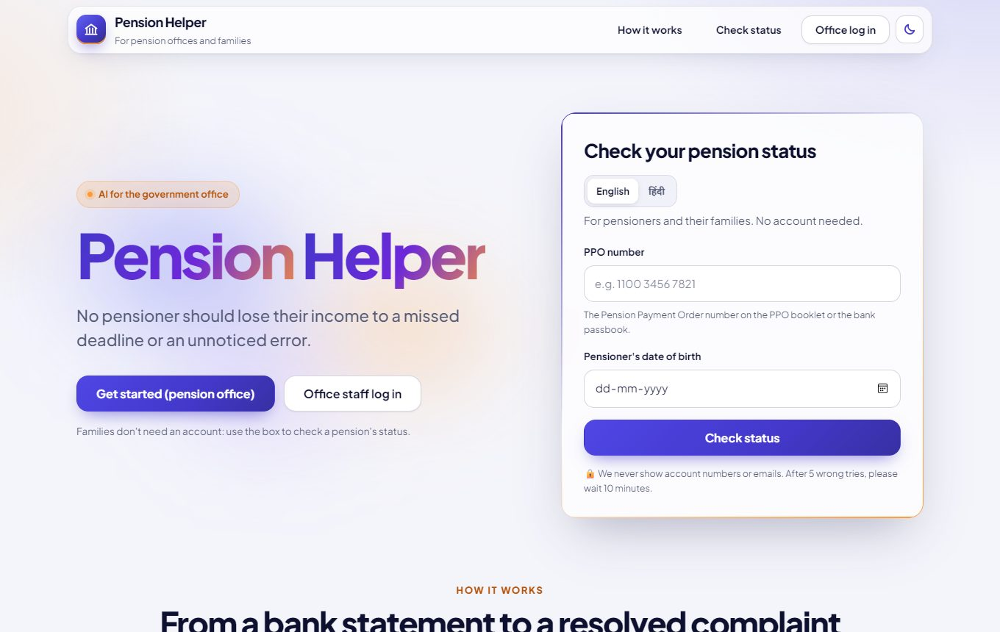

---

## The problem

For many elderly people the pension is their only income. It rarely stops because of one big mistake. It stops quietly, in three ways:

1. **A missed life certificate.** Every pensioner must submit a *Jeevan Pramaan* (digital life certificate) every year, by 30 November. Pensioners aged 80 and above can submit from 1 October, everyone else from 1 November. If it is missed, the pension can pause from December until it is submitted. Offices track this by hand for hundreds of people.
2. **An unnoticed short payment.** When the Dearness Relief (DA) rate goes up, the bank must pay more. Sometimes it doesn't, or a whole month is not paid. Nobody compares every month's credit against the expected amount.
3. **Complaints are hard.** Families often don't know how to write to the bank, and once they do, nobody can see what happened next.

## The solution

**Pension Helper does the checking. People make the decisions.**

| Job | What Pension Helper does |
|---|---|
| **Verify once** | The office records the Jeevan Pramaan ID once. The pensioner shows “Verified until 30 Nov next year” and gets no more reminders that year. |
| **Check payments in minutes** | The office uploads bank statements (CSV or PDF). Every month is compared with *basic pension + DA − commuted amount*, using the DA rates set in Settings. Missing and short months are flagged. |
| **Guide families to resolution** | Claude (Anthropic's AI) drafts a polite complaint letter to the bank. A person in the office approves it. The family follows it from home: Drafted → Approved → Sent to bank → Resolved, in Hindi or English. |

## Features

**For families (no account needed)**
- **Status check:** a “Check your pension status” box on the home page, using just the **PPO number + date of birth**.
- **Read-only status page:** life certificate (days left / verified until), month-by-month payments, the complaint tracker and clear next steps.
- **Hindi / English** switch on every family screen.
- **Protection against guessing:** after 5 wrong tries, a 10-minute wait.

**For pension office staff**
- **Accounts:** sign up and log in, with passwords stored as PBKDF2 hashes and a 10-minute lock after 5 wrong passwords.
- **Separate data:** each office gets a private workspace and never sees another office's data.
- **3-step guided setup:** office details → consent → upload documents.
- **Pensioner list upload (CSV):** a downloadable template, with every row checked and errors shown row by row. Nothing is imported if any row is wrong.
- **Bank statement upload (CSV or text PDF, several at once):** each statement is matched to its pensioner automatically by the last 4 digits of the account or PPO number, with a preview before saving.
- **Dashboard:**
  - certificates due and money pending
  - a deadline bar
  - a searchable pensioner list
  - a details panel with month-by-month payment bars
- **“Draft letters now”:** Claude writes the complaint letters. Each letter needs approval and is then tracked to resolution.
- **Settings:** DA rates per office, password change, and an activity (audit) log.

**Automations (n8n)**
- **Every day, 9 AM:** Claude writes a kind life-certificate reminder in the family's language (13 Indian languages supported), and Gmail sends it.
- **Every day, 8 AM:** a summary email for each office.
- **5th of each month:** a payment check for everyone, plus new letter drafts.
- **Never automatic:** a person approves every letter. If the AI is busy, a template letter is used instead.

**Design**
- Deep indigo and saffron, glass cards, light and dark mode.
- Animations made with GSAP, with “reduce motion” respected.
- Works on phones.

## Screenshots

| Family: status page | Family: Hindi |
|---|---|
| 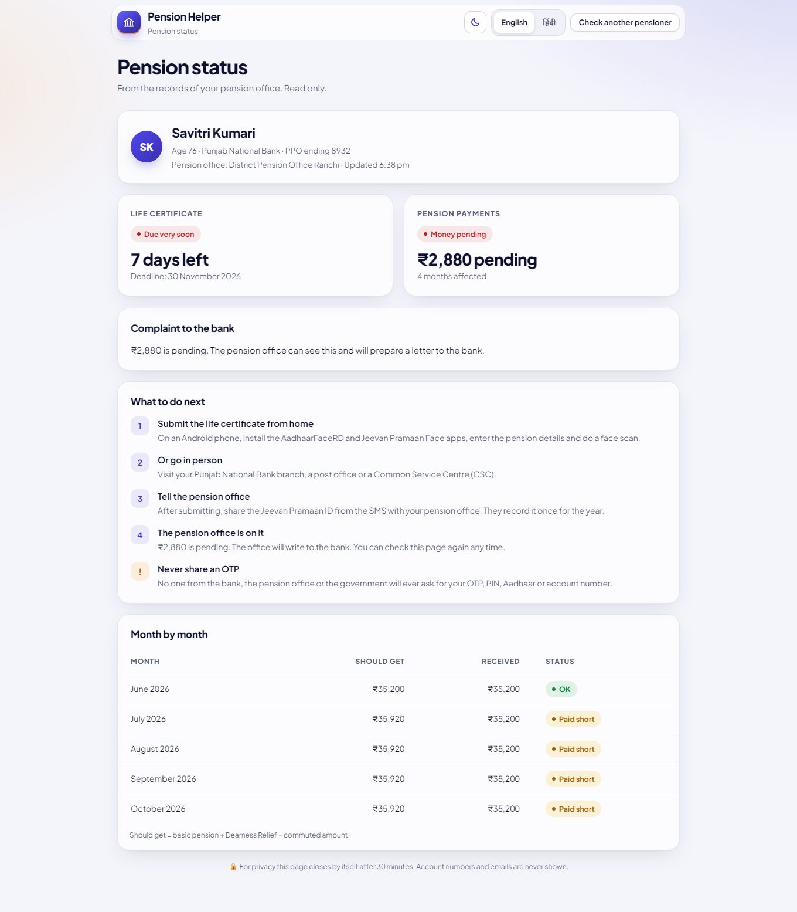 | 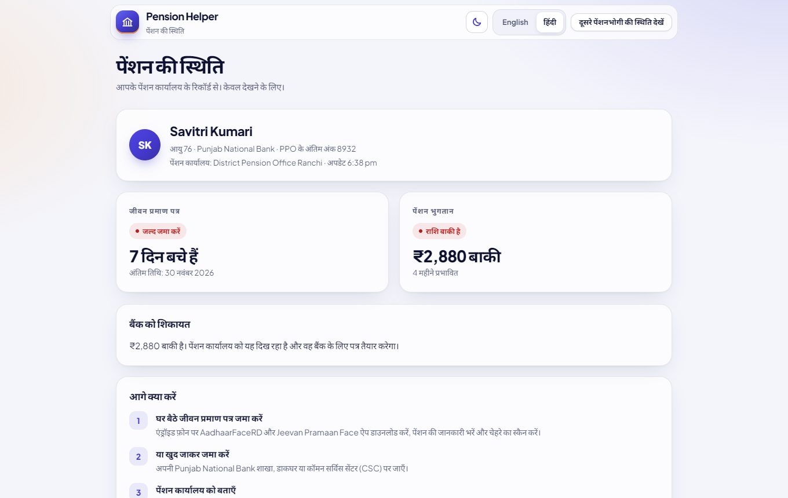 |
| **Office: dashboard** | **Office: pensioner details** |
| 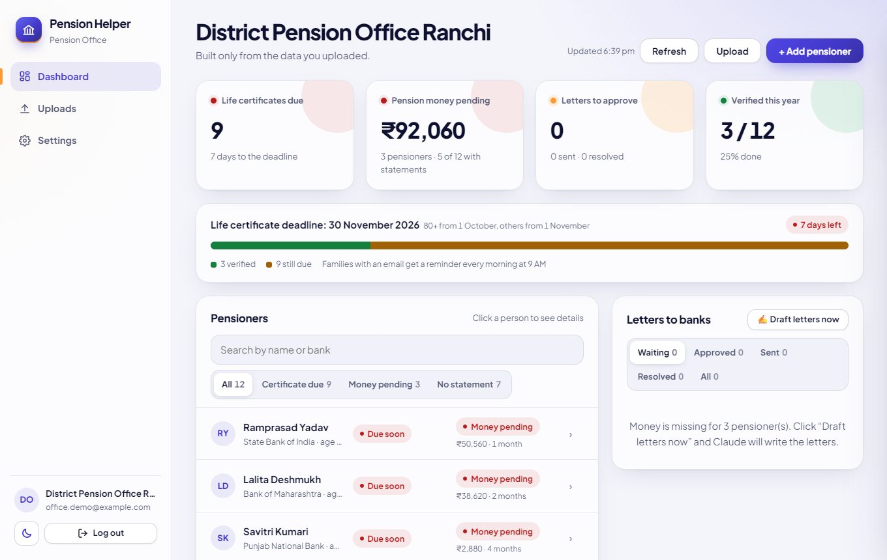 | 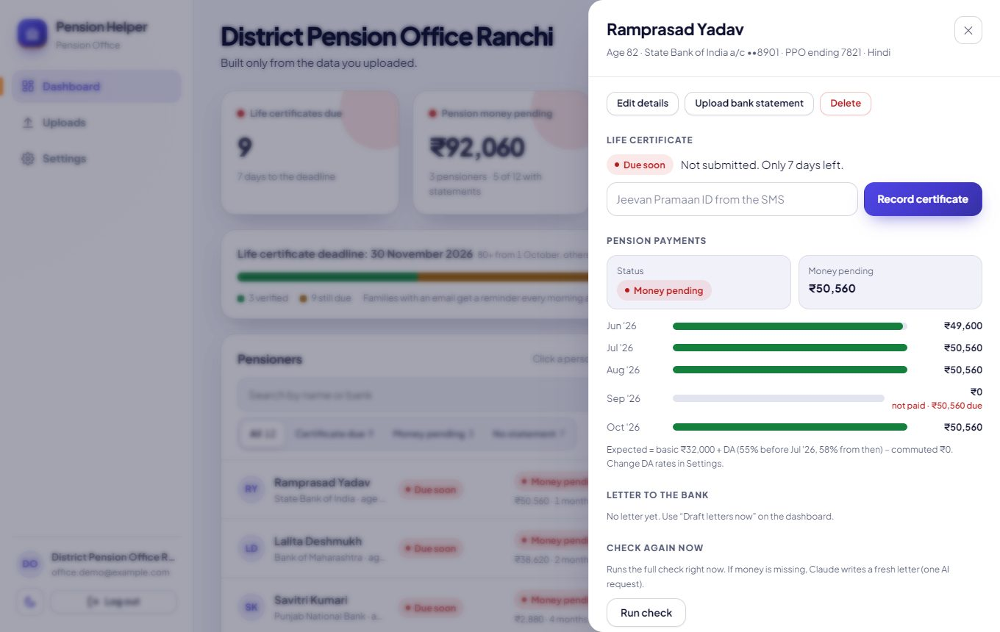 |
| **How it works** | **Dark mode** |
| 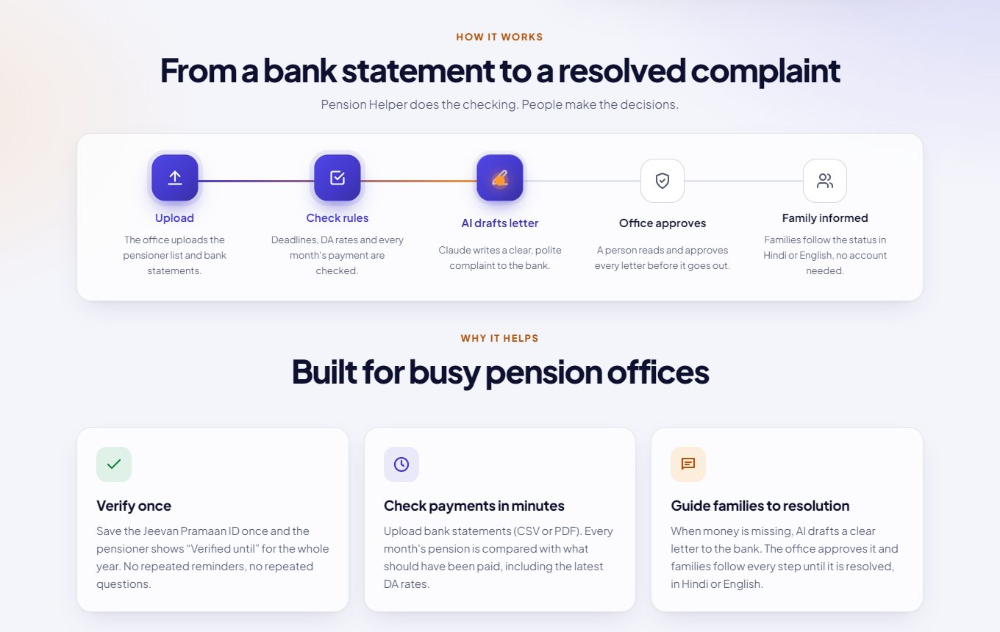 | 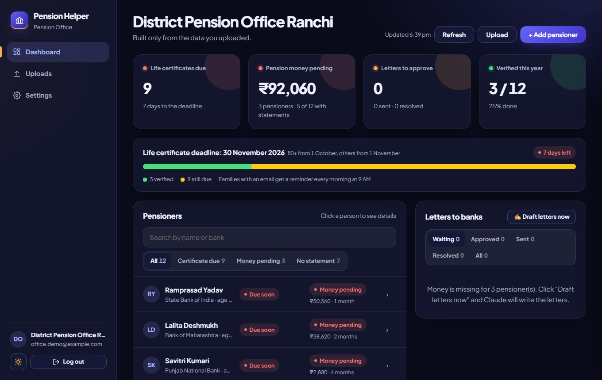 |

<p>
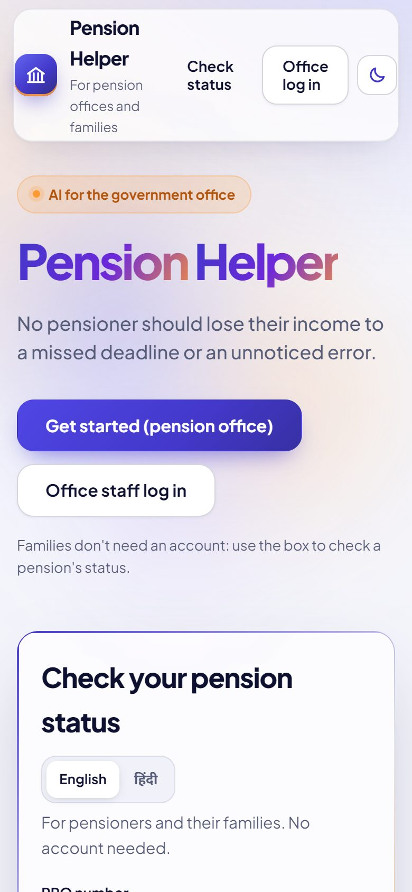
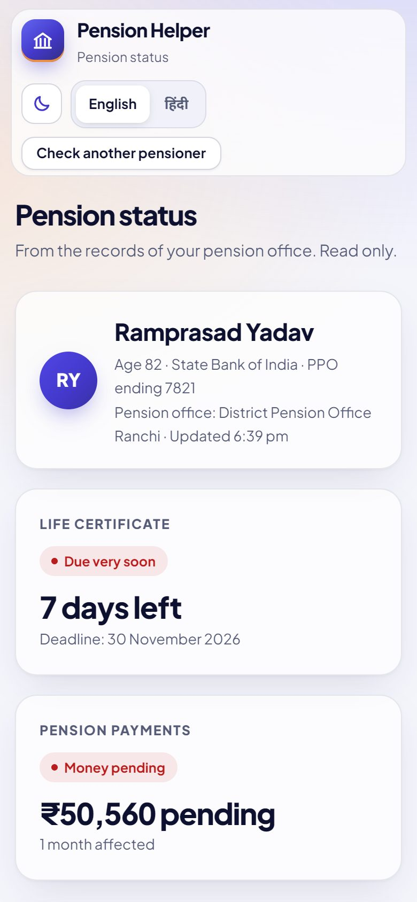
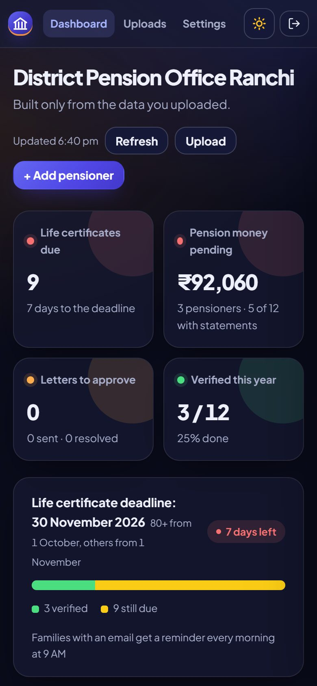
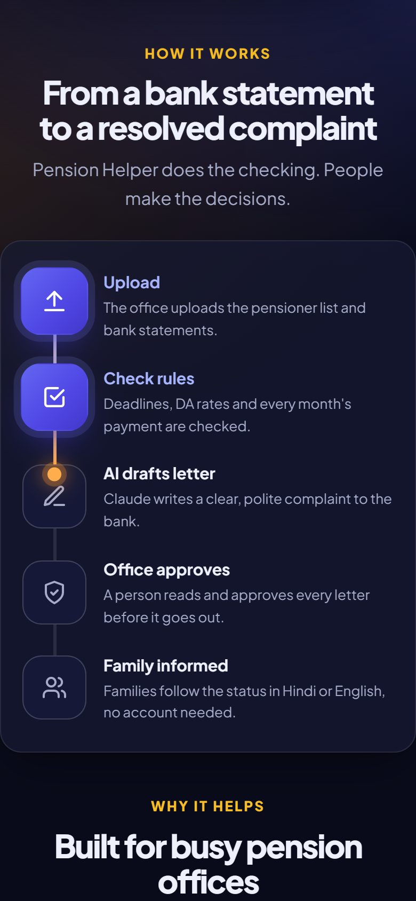
</p>

All 39 screenshots (every page, light and dark, desktop and phone) are in [`docs/screenshots/`](docs/screenshots/).

## Architecture

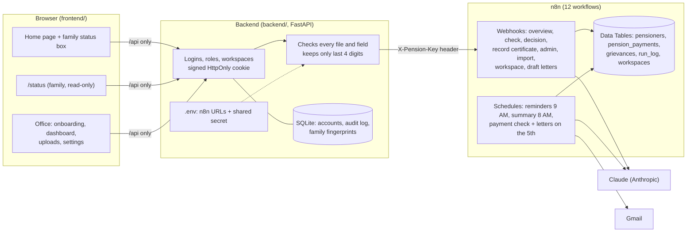

- **The browser never talks to n8n.** Pages only call `/api/...` on the backend. The n8n webhook URLs live only in `backend/.env`.
- **Every n8n webhook runs only with the secret key.** Each one checks the `X-Pension-Key` header (its “Only Run If” option) and ignores any request without it.
- **Each office's data is kept apart.** Each office has a workspace key (`w` + 9 digits), stored as the `dataset` value on every row in n8n.
- **Privacy by design:**
  - Full PPO and bank account numbers never leave the backend; only the last 4 digits are stored.
  - Bank statements are read in memory and never saved.
  - Dates of birth are never stored. The backend keeps only a one-way HMAC fingerprint of PPO + date of birth.

## Tech stack

| Part | Technology |
|---|---|
| Frontend | Plain HTML, CSS and JavaScript (no build step), [GSAP](https://gsap.com/) 3.12.5 for animation, Plus Jakarta Sans and Noto Sans Devanagari fonts |
| Backend | Python, [FastAPI](https://fastapi.tiangolo.com/), Uvicorn, httpx, pypdf (PDF statements), python-multipart, SQLite |
| Automation engine | [n8n](https://n8n.io/): Webhook, Schedule, Code, Data Table, If/Switch, Gmail and Anthropic (LangChain) nodes, plus n8n Data Tables |
| AI | Claude by Anthropic, via n8n's Anthropic node, with a template fallback |
| Email | Gmail through n8n |
| Tests | Python end-to-end tests (`tests/`) using httpx; screenshots made with Playwright |

## Project structure

```
backend/          FastAPI app (app.py), accounts DB (db.py), validation (models.py),
                  pensioner list reader (pensioner_list.py), bank statement reader (statements.py)
frontend/         Pages (index, status, login, signup, onboarding, office, uploads, settings) + assets/
workflows/        The 12 n8n workflows as JSON, ready to import (see workflows/README.md)
sample_uploads/   Made-up pensioner list and bank statements for demos
docs/screenshots/ Screenshots of every page
tests/            End-to-end tests (flow_test.py, status_test.py)
start.bat         One-click start on Windows
```

## Setup, step by step

### What you need
- **Python 3.11 or newer.**
- **An n8n instance:** [n8n Cloud](https://n8n.io/) or self-hosted, with **Data Tables** available.
- **An Anthropic API key**, for Claude. It is added as a credential *inside n8n*, never in this repo.
- **A Gmail account**, connected to n8n, for the reminder and summary emails. This is optional; without it, only the emails are skipped.

### 1. Get the code
```bash
git clone https://github.com/<your-username>/pension-helper.git
cd pension-helper
```

### 2. Make two random secrets
You need two long random values: one for `SESSION_SECRET` and one for `N8N_SHARED_SECRET`.
```bash
python -c "import secrets; print(secrets.token_urlsafe(32))"
```
Run it twice and keep both values. Don't share them.

### 3. Set up n8n
1. **Create the 5 Data Tables** with the columns listed in [`workflows/README.md`](workflows/README.md): `pensioners`, `pension_payments`, `grievances`, `run_log` and `workspaces`.
2. **Add credentials in n8n:**
   - **Anthropic** (your API key)
   - **Gmail** (OAuth)
3. **Import the workflows** (11, plus `12-backend-store.json` if you deploy on Render). In n8n, go to **Workflows → ⋯ → Import from File** and choose each file in `workflows/`.
4. **In each imported workflow:**
   - **Data Table nodes:** re-select the matching table. Table IDs are different in your n8n.
   - **Claude nodes:** pick your Anthropic credential.
   - **Gmail nodes:** pick your Gmail credential.
   - **Webhook nodes:** open **Options → Only Run If** and replace `REPLACE_WITH_YOUR_N8N_SHARED_SECRET` with your `N8N_SHARED_SECRET`.
   - **Workflow settings:** check that the timezone is **Asia/Kolkata**, so the 8 AM / 9 AM schedules use India time.
5. **Activate (publish) the workflows.** Workflow 03 (Payment Checker) is optional.

### 4. Configure the backend
Copy the example file and fill it in:
```bash
cp backend/.env.example backend/.env      # Windows: copy backend\.env.example backend\.env
```
- **Webhook URLs:** each one is your n8n address + `/webhook/` + the path, for example `https://your-instance.app.n8n.cloud/webhook/pension-overview`.
- **Secrets:** paste your two values from step 2.

`backend/.env` is git-ignored. Never commit it.

### 5. Start the app
- **Windows:** double-click **`start.bat`**. It creates a Python environment on the first run, installs the packages and opens http://localhost:8000.
- **macOS / Linux:**
  ```bash
  python3 -m venv backend/.venv
  backend/.venv/bin/pip install -r backend/requirements.txt
  backend/.venv/bin/python -m uvicorn app:app --app-dir backend --host 127.0.0.1 --port 8000
  ```

### 6. Try it with sample data
1. Open http://localhost:8000, click **Get started (pension office)** and create an office account.
2. Finish the 3 setup steps. In step 3, upload `sample_uploads/pensioner_list.csv`, then the 5 sample statements.
3. On the dashboard, click **Draft letters now**, then open and approve a letter.
4. On the home page, check a status as a family would: PPO **1100 3456 7821** and date of birth **12/03/1944** (Ramprasad Yadav).

See [`sample_uploads/README.md`](sample_uploads/README.md) for the full demo script.

### Deploy on Render (free plan)

Render runs the frontend and the backend as **one web service**. The backend serves the pages too.

1. Import `workflows/12-backend-store.json` into n8n, and create its `backend_store` table (see [`workflows/README.md`](workflows/README.md)).
   - **Why:** Render's free plan wipes the server's disk on every restart.
   - **What it does:** the app keeps a copy of accounts (password hashes only), workspaces and family-check fingerprints in n8n, and reloads them when it starts with an empty disk.
2. On [render.com](https://render.com), create a **New → Web Service** from your GitHub repo. You can also use **New → Blueprint**, which reads [`render.yaml`](render.yaml).
3. Fill in the settings:
   - **Runtime:** Python
   - **Build command:** `pip install -r backend/requirements.txt`
   - **Start command:** `uvicorn app:app --app-dir backend --host 0.0.0.0 --port $PORT`
   - **Health check path:** `/healthz`
4. Add the environment variables:
   - **n8n addresses:** `N8N_OVERVIEW_URL`, `N8N_CHECK_URL`, `N8N_DECISION_URL`, `N8N_RECORD_URL`, `N8N_ADMIN_URL`, `N8N_IMPORT_URL`, `N8N_WORKSPACE_URL`, `N8N_DRAFT_URL`, `N8N_STORE_URL` (your n8n address + `/webhook/backend-store`)
   - **Secrets:** `N8N_SHARED_SECRET`, `SESSION_SECRET`
   - **Optional sample office**, recreated if it's missing: `SEED_OFFICE_EMAIL`, `SEED_OFFICE_PASSWORD` (10+ characters), and `SEED_WORKSPACE_KEY` to link it to sample data already in n8n
   - **Optional Python version:** `PYTHON_VERSION` (for example `3.12.8`)

On Render the session cookie is automatically HTTPS-only. The "5 wrong tries" limit uses each visitor's real address. On the free plan, the service sleeps after about 15 minutes without visitors, so the first visit after that takes up to a minute.

`tests/render_test.py` checks that accounts survive a restart with an empty disk. It uses, and then empties, the `backend_store` table, so don't run it while a hosted copy is live.

### 7. Run the tests (optional)
Each test starts its own copy of the app with a throwaway accounts database. It uses your real n8n, asks Claude for a few letters (a small cost), and deletes its test data afterwards.
```bash
backend/.venv/bin/python tests/flow_test.py      # whole app (66 checks)
backend/.venv/bin/python tests/status_test.py    # family status check (42 checks)
```

## Sample data

All data in this repository is **made up**. There are no real Aadhaar, PPO or bank account numbers, and no real people.
- **`sample_uploads/pensioner_list.csv`:** 12 pensioners in different languages, 3 with a certificate already verified, and dates of birth so the family check works.
- **`sample_uploads/pensioner_list_with_errors.csv`:** shows the row-by-row error messages (6 errors).
- **5 bank statements (3 CSV, 2 PDF):**
  - a missing month (Ramprasad, September)
  - a DA increase not applied (Savitri, ₹720 short each month)
  - a short month plus a missing month (Lalita)
  - two statements paid in full
- **`family_statement_kamla_devi_SBI.csv`** and **`not_a_statement.csv`:** an extra statement, and a file the app rejects with a clear message.
- **Sample family email addresses** use `example.com`, which never receives mail. The reminder workflow skips them.

## Limitations

- **Hosting:** it runs locally, or on Render's free plan (see "Deploy on Render"). On Render:
  - The activity log and the wrong-password counters start fresh after each restart; accounts and data are kept.
  - The free plan sleeps when idle.
- **Jeevan Pramaan IDs are only format-checked.** They are not verified with the official Jeevan Pramaan service.
- **Bank statements:** generic CSV layouts and text-based PDFs only. Scanned PDFs are refused, because there is no OCR.
- **DA rates** are entered by hand in Settings. The defaults (55% and 58%) are demo values.
- **Forgot password** is a placeholder; there is no email reset yet.
- **n8n Data Tables** are fine for a pilot. A large office would move to a proper database.
- **Pensioner names** link payments and letters inside a workspace, so two pensioners in one office can't share exactly the same name.

## Roadmap

- **Hosting:** move accounts to a managed database on a paid plan, so the activity log survives restarts too.
- **Certificate check:** verify Jeevan Pramaan IDs with the official service.
- **Statements:** bank-specific statement formats, and OCR for scanned statements.
- **Accounts:** password reset by email, and several staff users with roles inside one office.
- **More channels:** SMS or WhatsApp reminders for families without email.
- **DA rates:** import official DA orders automatically.

## Security

- Never commit `backend/.env`, real data or API keys. The `.gitignore` already blocks `.env` files, databases and key files.
- To change the shared secret, update `backend/.env` **and** the “Only Run If” option in the 8 webhook workflows.

## License

[MIT](LICENSE): free to use, change and share, with the copyright notice kept.

---

Built for the Homingo hackathon · Automation track B2: AI for the government office.
